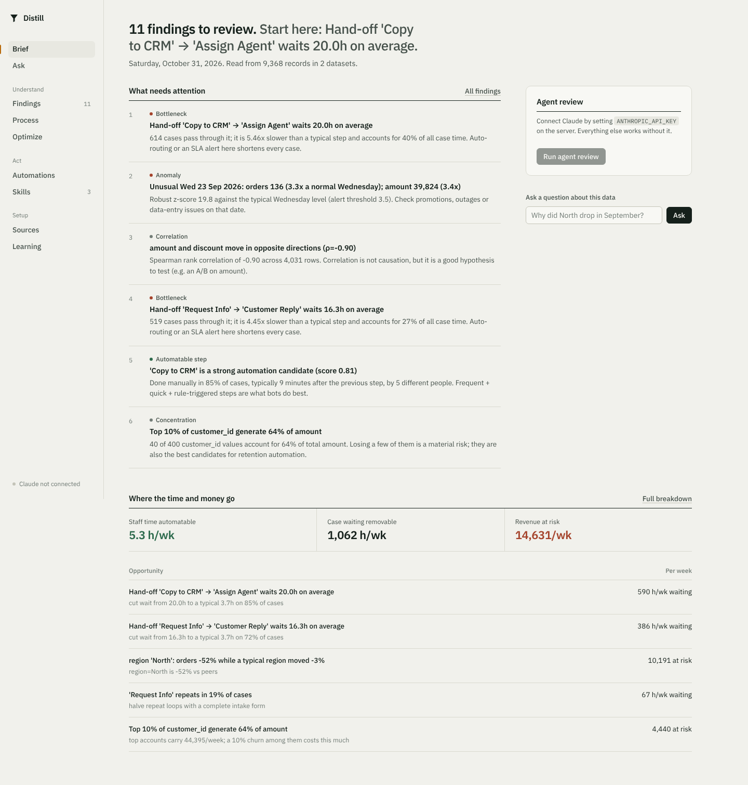
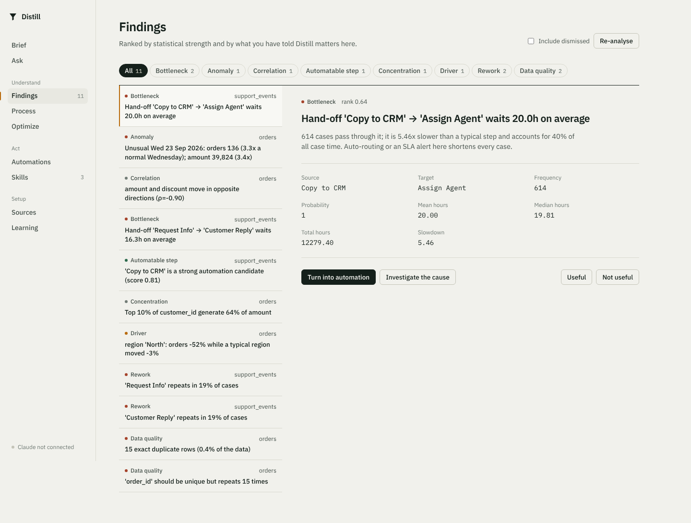
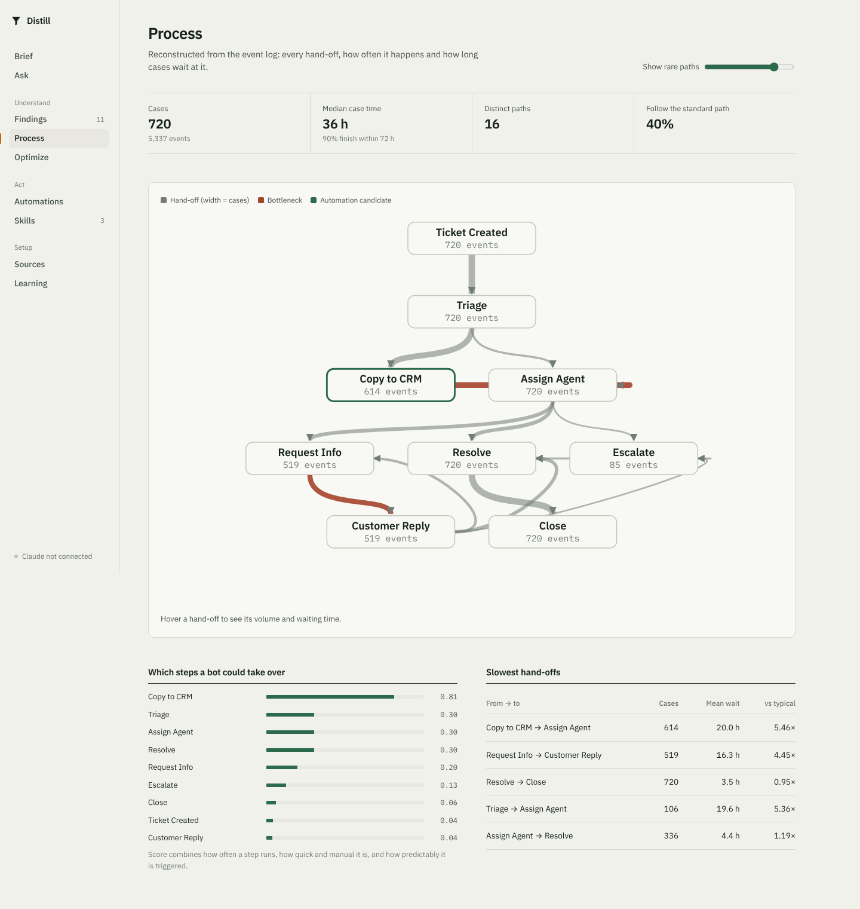
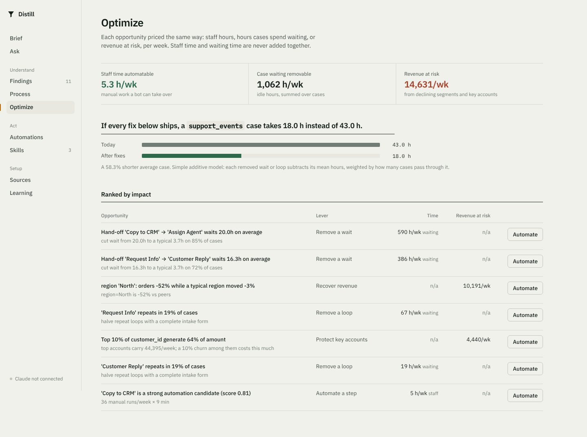
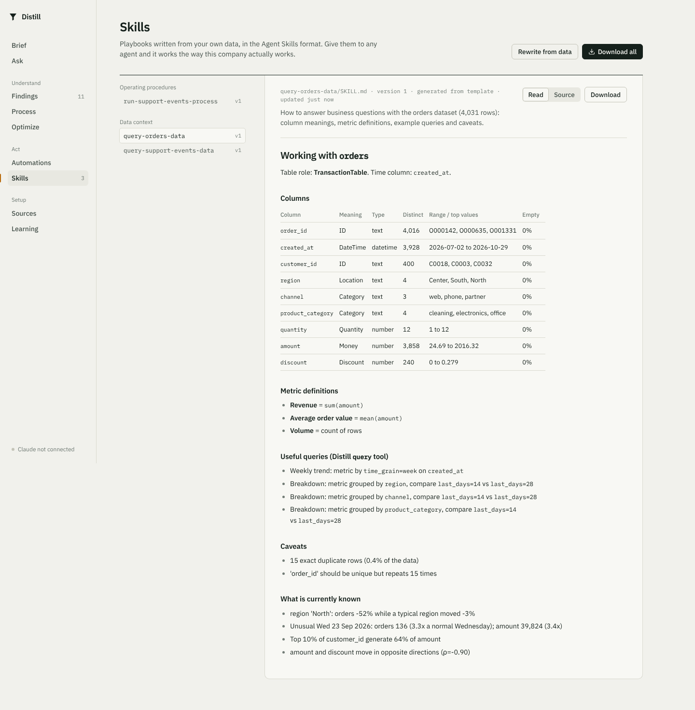
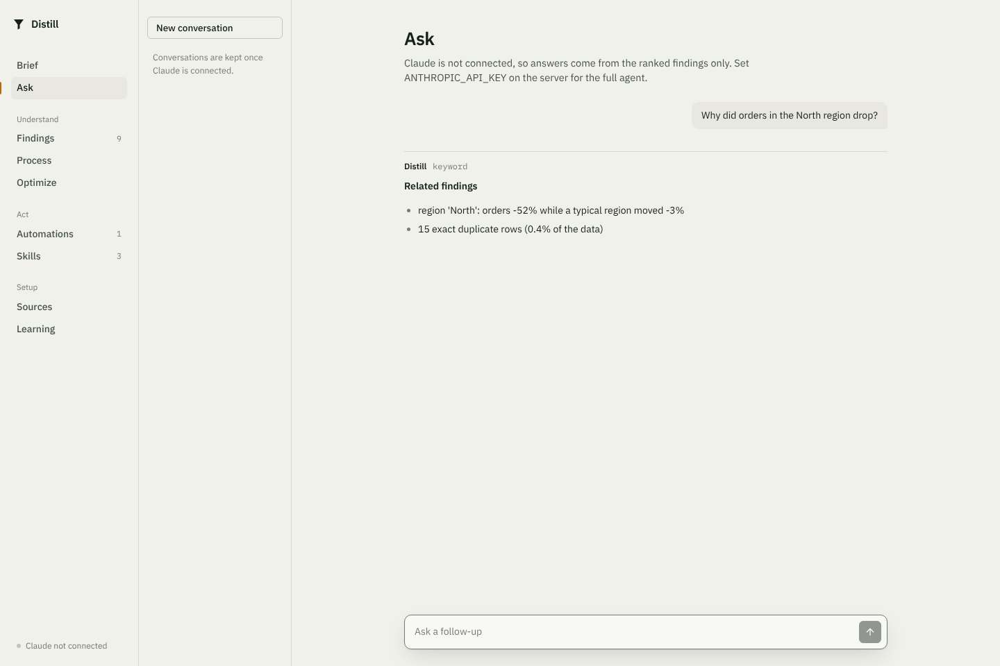
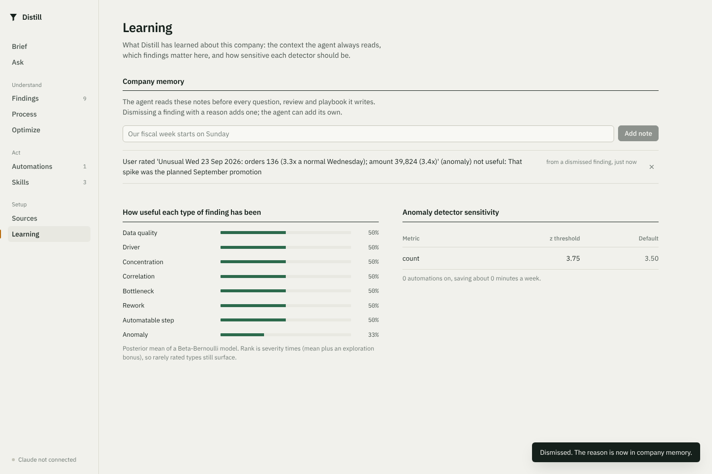

# Distill

Distill reads a company's operational data and tells you what changed, where work gets stuck, and what is
worth automating. Then it does something about it: every finding can become a monitoring automation, an
importable workflow, and an Agent Skill that teaches any AI agent how this particular company runs.

A Claude agent sits at the centre. It answers questions by running aggregate queries on the data, reviews
every finding on request and drafts automations for a person to approve, remembers what the team tells it,
and rewrites the generated playbooks. Feedback on findings changes how they are ranked and how sensitive the
detectors are.



## What it does

| Layer | What happens | Code |
|---|---|---|
| **Collect** | Connectors for CSV/JSON, REST APIs, SQL databases and push webhooks. Incremental syncs resume from a saved cursor and can run on a schedule. | `connectors/`, `ingest.py`, `scheduler.py` |
| **Understand** | Fingerprints every column, detects semantic types (money, time, location, case id) and the table's role. Claude writes a business glossary per dataset with structured outputs. | `profiler.py`, `agent.glossary` |
| **Check quality** | On every sync: duplicate rows, duplicate keys, missing values, impossible ranges, future timestamps. Any check can become a guard automation. | `insights.data_quality` |
| **Analyse** | Trends, segment drivers (median-peer baseline plus Welch test), seasonality-adjusted anomalies, concentration, correlations. | `insights.py` |
| **Mine processes** | Directly-follows graph from event logs: paths, bottlenecks, rework loops, automation potential per step. | `process_mining.py` |
| **Optimize** | Every opportunity priced in staff hours, case waiting hours or revenue at risk per week, ranked, with a what-if on cycle time. Staff time and waiting time are never summed together. | `optimization.py` |
| **Write skills** | Versioned Agent Skills generated from the data: an operating procedure per process (real timings as SLAs, decision points, known delays) and a data-context skill per dataset (column meanings, metric definitions, caveats). Downloadable as a zip. | `skills.py` |
| **Act** | Each finding compiles into a rule Distill evaluates on schedule, an importable n8n workflow, and a SKILL.md playbook. | `automations.py` |
| **Learn** | A Beta-Bernoulli model per finding type re-ranks the feed, anomaly thresholds tune themselves per metric, and dismiss reasons become company memory. | `learning.py` |

## The agent

- **Ask.** A multi-turn Claude agent (`claude-opus-5-5`) with 10 strict tools: list and describe datasets, run
  aggregate queries, read findings, process models and optimization opportunities, list skills, create and run
  automations, and `remember` facts. Conversations keep the full API transcript, so follow-up questions keep
  their context. Every tool call is shown under the answer.
- **Agent review.** One action: the agent reads every finding, investigates the most valuable, drafts
  automations (switched off until a person approves them) and writes up what it found.
- **Company memory.** Notes from the team, reasons given when a finding is dismissed, and facts the agent chose
  to keep are injected into every agent task.
- **Skills and glossaries.** Templates guarantee the numbers; Claude rewrites them into fuller playbooks and
  writes column meanings with JSON-schema structured outputs.
- **Bounded by design.** The model only receives aggregates it asked for (at most 60 rows): no raw rows, no SQL,
  no code execution. Loops stop after 10 steps, refusals are handled, and server-side fallbacks keep requests
  alive.
- **Works without a key.** Every agent feature has a deterministic fallback, so the platform runs, and its tests
  pass, offline.

## Screens

| | |
|---|---|
|  |  |
|  |  |
|  |  |

The interface follows a written design language, see [DESIGN.md](DESIGN.md). Light and dark themes follow the
system setting.

## Quick start
```bash
# backend
cd backend && python -m venv .venv && . .venv/bin/activate
pip install -e ".[llm,dev]"
export ANTHROPIC_API_KEY=...        # optional, enables the agent
uvicorn distill.api:app --reload    # http://localhost:8000/docs

# frontend
cd frontend && npm install && npm run dev   # http://localhost:5173
# or: npm run build, and the backend serves the UI at http://localhost:8000
```
Choose **Load the demo company**: 120 days of orders and support tickets from a small online retailer, with a
regional slump, a spike, a few dominant customers, a discount effect, a slow hand-off, a manual copy-paste step
and duplicated records hidden in it. Docker: `docker build -t distill . && docker run -p 8000:8000 distill`.

`DISTILL_SCHEDULER=0` turns off the background scheduler; `DISTILL_DATABASE_URL` switches SQLite for Postgres.

## Tests
```bash
cd backend && pytest     # 32 tests
```
They include statistical contracts (the segment-driver detector must find the planted effect in at least 17 of
20 random companies with at most 5 spurious findings), offline tests of the agent loop, multi-turn chat, memory,
agent review and structured outputs against a scripted Claude client, and API tests for skills, optimization,
data-quality guards and the scheduler.

## Design notes
- Connectors emit a small typed message stream (RECORD / STATE / LOG), so a new source is a short class.
- Segment drivers are compared against the median peer, not the pooled rest: a pooled baseline makes every
  healthy segment look divergent whenever one segment collapses.
- Skills are versioned by content hash. Re-syncing unchanged data keeps v1; when the business changes, the
  version moves with it.

## Stack
FastAPI, SQLAlchemy 2 (SQLite or Postgres), pandas and numpy, Anthropic Python SDK, React 19 with TypeScript and
Vite, hand-drawn SVG charts and process map, IBM Plex.

## API (selected)
`POST /api/chat`, `POST /api/autopilot`, `GET /api/briefings`, `GET|POST|DELETE /api/memory`, `GET /api/skills`,
`POST /api/skills/generate`, `GET /api/skills/export.zip`, `GET /api/optimization`, `POST /api/sources/{id}/sync`,
`POST /api/sources/{id}/events`, `GET /api/insights`, `POST /api/insights/{id}/feedback`,
`POST /api/insights/{id}/investigate`, `POST /api/insights/{id}/automate`, `POST /api/automations/{id}/evaluate`,
`GET /api/automations/{id}/n8n.json`. Full OpenAPI docs at `/docs`.
