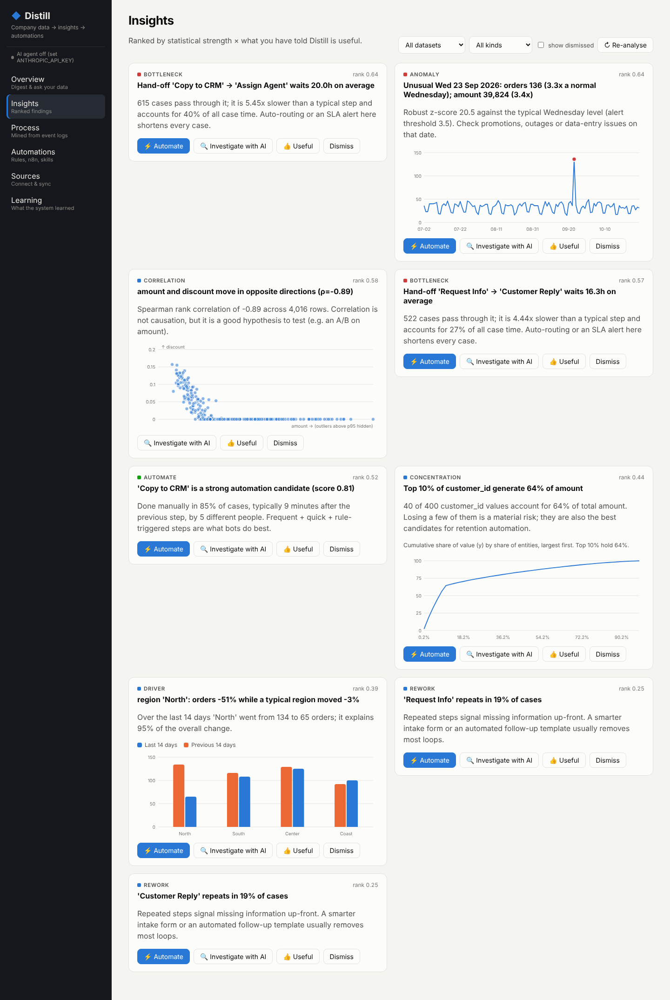

# Distill: company data → insights → automations

**An AI-native data platform.** It collects a company's operational data, finds what changed,
what is slow and what can be automated, explains *why* with a Claude analyst agent, and compiles every finding
into a working automation: a monitoring rule, an importable **n8n workflow** and an **Agent Skill (SKILL.md)**.
User feedback teaches it what matters, so it improves over time.



## What it does

| Layer | What happens | Code |
|---|---|---|
| **Collect** | Connectors for CSV/JSON, REST APIs, SQL databases and push webhooks. Incremental sync with saved cursors (Airbyte-style protocol). | `connectors/`, `ingest.py` |
| **Understand** | Fingerprints every column, detects semantic types (money, time, location, case id…) and the table's role (transactions, event log…). | `profiler.py` |
| **Analyse** | Role-specific templates: trends, segment drivers (Welch-tested), seasonality-adjusted anomalies, Pareto concentration, correlations. | `insights.py` |
| **Mine processes** | Builds the directly-follows graph from event logs: variants, bottlenecks, rework loops, automation potential per step. | `process_mining.py` |
| **Reason (AI)** | A Claude Opus 5.5 agent with tools runs aggregate queries, reads findings and process models, and investigates root causes. It also writes the executive digest and the SKILL.md playbooks. | `agent.py`, `narrator.py` |
| **Act** | Each finding compiles into a rule Distill can evaluate, plus an n8n workflow and an Agent Skill. | `automations.py` |
| **Learn** | A Beta-Bernoulli bandit per insight kind re-ranks the feed; anomaly thresholds self-tune per metric; dismissed findings stay suppressed. | `learning.py` |

## AI-native by design
- **Analyst agent**: a manual tool-use loop on the Claude Messages API (`claude-opus-5-5`, adaptive thinking,
  per-task effort, strict tool schemas, server-side refusal fallbacks). 7 tools, max 10 steps, with a full tool
  trace shown in the UI.
- **Safe by construction**: the model only ever receives aggregates it asked for (≤60 rows). It gets no raw
  rows, no SQL and no code execution. Automations it creates start disabled, for human review.
- **Graceful without a key**: every AI feature has a deterministic fallback, so the platform still runs (and its
  tests pass) offline.

## Quick start
```bash
# backend
cd backend && python -m venv .venv && . .venv/bin/activate
pip install -e ".[llm,dev]"
export ANTHROPIC_API_KEY=...        # optional, enables the AI agent
uvicorn distill.api:app --reload    # http://localhost:8000/docs

# frontend
cd frontend && npm install && npm run dev   # http://localhost:5173
# or: npm run build, and the backend serves the UI at http://localhost:8000
```
Click **Load demo company**: 120 days of orders plus a support-desk event log with planted patterns
(a regional drop, a spike, whale customers, a discount effect, a hand-off bottleneck, a manual copy-paste step).

## Tests
```bash
cd backend && pytest     # 23 tests
```
They include **statistical contracts** (the segment-driver detector must find the planted effect in ≥17 of 20
random companies with ≤5 spurious findings) and offline tests of the agent loop with a scripted Claude client.

## Design notes
- Connectors speak an Airbyte-style message protocol (RECORD / STATE / LOG), so new sources are small classes.
- Automations export in n8n's native workflow format and as Agent Skills, so they run in tools teams already use.
- Segment drivers are compared against the *median peer*, not the pooled rest: a pooled baseline makes every
  healthy segment look divergent whenever one segment collapses.

## Stack
FastAPI · SQLAlchemy 2 (SQLite / Postgres) · pandas/numpy · Anthropic Python SDK · React 19 + TypeScript + Vite ·
hand-built SVG charts and process map.

## API (selected)
`POST /api/demo` · `POST /api/sources` · `POST /api/sources/{id}/sync` · `POST /api/sources/{id}/events` ·
`GET /api/insights` · `POST /api/insights/{id}/feedback` · `POST /api/insights/{id}/investigate` ·
`POST /api/insights/{id}/automate` · `POST /api/automations/{id}/evaluate` · `GET /api/automations/{id}/n8n.json` ·
`GET /api/automations/{id}/SKILL.md` · `POST /api/ask` · `GET /api/learning`. Full OpenAPI docs at `/docs`.
